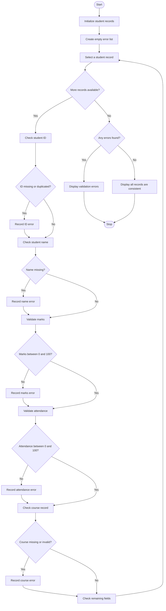

. Problem Statement

The Integrated Student Record Consistency Checker is designed to validate student academic records stored in Python lists and tuples. It checks student identifiers, names, marks, attendance percentages, and course records for errors. The program identifies duplicate student IDs, missing values, invalid marks, incorrect attendance percentages, and inconsistent course records. It displays validation results and helps maintain accurate and consistent student information.

2. Algorithm

1.Start the program.

2.Initialize student records using lists and tuples containing student ID, name, marks, attendance percentage, and course name.

3.Initialize an empty list to store validation errors.

4.Read each student record one by one.

5.Check whether the student ID is missing or duplicated.

6.Check whether the student name is missing.

7.Validate marks to ensure they are between 0 and 100.

8.Validate attendance to ensure it is between 0% and 100%.

9.Check whether the course name is missing or invalid.

10.Record any errors found in the student records.

11.Display the validation results for each student.

12.If no errors are found, display a message indicating that all records are consistent.

13.Stop the program.

3. Flowchart Using Mermaid
4.```mermaid
### 3. Flowchart Using Mermaid



4. Python Program Code

# Integrated Student Record Consistency Checker

# Valid course names
valid_courses = ("CSE", "ECE", "EEE", "IT")

# Student records stored as tuples inside a list
students = [
    (101, "Ravi", 85, 92, "CSE"),
    (102, "Sita", 90, 88, "ECE"),
    (101, "Kiran", 75, 95, "CSE"),
    (103, "", 105, 70, "IT"),
    (104, "Anu", 80, 110, ""),
    (None, "Rahul", 65, 85, "EEE")
]

# List to store validation errors
errors = []

# Check each student record
for student in students:
    student_id, name, marks, attendance, course = student
    student_errors = []

    # Check missing student ID
    if student_id is None or student_id == "":
        student_errors.append("Missing student ID")

    # Check duplicate student ID
    elif sum(1 for s in students if s[0] == student_id) > 1:
        student_errors.append("Duplicate student ID")

    # Check student name
    if name is None or name == "":
        student_errors.append("Missing student name")

    # Check marks
    if marks is None or marks == "":
        student_errors.append("Missing marks")
    elif not isinstance(marks, (int, float)) or not 0 <= marks <= 100:
        student_errors.append("Invalid marks")

    # Check attendance
    if attendance is None or attendance == "":
        student_errors.append("Missing attendance")
    elif (
        not isinstance(attendance, (int, float))
        or not 0 <= attendance <= 100
    ):
        student_errors.append("Invalid attendance")

    # Check course
    if course is None or course == "":
        student_errors.append("Missing course")
    elif course not in valid_courses:
        student_errors.append("Invalid course")

    # Store errors if found
    if student_errors:
        errors.append((student_id, student_errors))

# Display validation results
print("STUDENT RECORD VALIDATION REPORT")
print("--------------------------------")

if len(errors) == 0:
    print("All student records are consistent.")
else:
    for record in errors:
        print("\nStudent ID:", record[0])
        for error in record[1]:
            print("-", error)

print("\nTotal student records:", len(students))
print("Records with errors:", len(errors))
print("Records without errors:", len(students) - len(errors))

5. Sample Output

STUDENT RECORD VALIDATION REPORT
--------------------------------

Student ID: 101
- Duplicate student ID

Student ID: 101
- Duplicate student ID

Student ID: 103
- Missing student name
- Invalid marks

Student ID: 104
- Invalid attendance
- Missing course

Student ID: None
- Missing student ID

Total student records: 6
Records with errors: 5
Records without errors: 1


