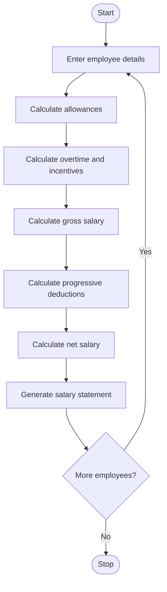

1. Problem Statement
The Employee Payroll and Deduction Analysis system calculates employees' salaries based on basic pay, allowances, overtime, and incentives. It determines the gross salary by adding all earnings and calculates deductions using progressive deduction rates. Finally, the program calculates the net salary after deducting the applicable amounts and generates a formatted salary statement for each employee.
2. Algorithm
1. Start the program.
2. Initialize employee details, including employee ID, name, and basic salary.
3. Calculate allowances based on the basic salary.
4. Calculate overtime pay and incentives.
5. Calculate gross salary by adding basic salary, allowances, overtime pay, and incentives.
6. Calculate deductions using progressive deduction slabs.
7. Calculate net salary by subtracting total deductions from gross salary.
8. Display the employee's salary statement, including earnings, deductions, and net salary.
9. Repeat the process for all employees.
10. Stop the program.
3. Flowchart Using Mermaid

4. Python Program Code
Save this program as employee_payroll.py.
# Employee Payroll and Deduction Analysis# Employee details stored as tuples inside a listemployees = [    (101, "Ravi", 30000, 5000, 2000, 3000),    (102, "Sita", 45000, 7000, 3000, 5000),    (103, "Kiran", 20000, 3000, 1000, 1500)]# Progressive deduction slabsdef calculate_deduction(gross_salary):    deduction = 0    if gross_salary <= 20000:        deduction = gross_salary * 0.05    elif gross_salary <= 40000:        deduction = (20000 * 0.05) + (            (gross_salary - 20000) * 0.10        )    else:        deduction = (            (20000 * 0.05)            + (20000 * 0.10)            + ((gross_salary - 40000) * 0.15)        )    return deduction# Process employee payrollfor employee in employees:    emp_id, name, basic, allowances, overtime, incentives = employee

