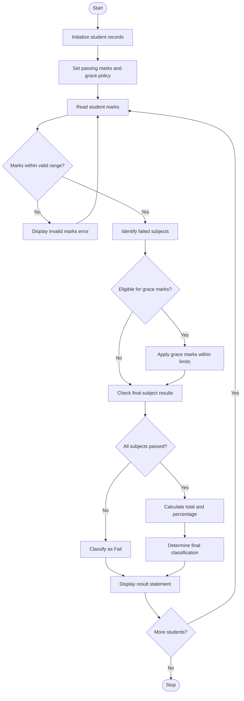

1. Problem Statement
The Examination Result and Grace-Mark Validation system processes students' marks across multiple subjects and determines their final examination results. The program checks subject-wise pass criteria, applies a specified grace-mark policy to eligible students, and ensures that the marks awarded do not exceed the maximum marks for any subject. Finally, it calculates total marks, percentages, and final classifications, such as Distinction, First Class, Second Class, or Fail.
2. Algorithm
1. Start the program.
2. Initialize student details and subject-wise marks.
3. Define the maximum marks and minimum passing marks for each subject.
4. Define the grace-mark policy and maximum grace marks allowed.
5. Read each student's marks for all subjects.
6. Check whether the marks are within the valid range.
7. Identify subjects in which the student has failed.
8. Check whether the student is eligible for grace marks under the specified policy.
9. Apply grace marks to eligible subjects without exceeding the maximum marks.
10. Recheck the pass criteria for all subjects.
11. Calculate total marks and percentage.
12. Determine the final result and classification.
13. Display the student's marks, grace marks awarded, total, percentage, and final result.
14. Repeat the process for all students.
15. Stop the program.
3. Flowchart Using Mermaid

4. Python Program Code
```python
# Examination Result and Grace-Mark Validation

MAX_MARKS = 100
PASS_MARKS = 35
MAX_GRACE = 5

# Student records: ID, Name, Subject Marks
students = [
    (101, "Anu", [78, 82, 90]),
    (102, "Ravi", [65, 58, 72]),
    (103, "Kiran", [32, 70, 68]),
    (104, "Sita", [25, 40, 60])
]

# Process each student's result
for student in students:
    student_id, name, original_marks = student
    marks = original_marks.copy()
    grace_awarded = 0

    # Validate marks
    invalid = any(
        not isinstance(mark, (int, float))
        or isinstance(mark, bool)
        or mark < 0
        or mark > MAX_MARKS
        for mark in marks
    )

    if invalid:
        print("\nInvalid marks for:", name)
        continue

    # Identify failed subjects
    failed = [
        i for i, mark in enumerate(marks)
        if mark < PASS_MARKS
    ]

    # Apply grace marks if exactly one subject has a small shortfall
    if len(failed) == 1:
        i = failed[0]
        shortfall = PASS_MARKS - marks[i]

        if 0 < shortfall <= MAX_GRACE:
            grace_awarded = shortfall
            marks[i] += grace_awarded

    # Check whether all subjects are passed
    passed = all(mark >= PASS_MARKS for mark in marks)

    # Calculate total and percentage
    total = sum(marks)
    percentage = total / (len(marks) * MAX_MARKS) * 100

    # Determine final classification
    if not passed:
        classification = "Fail"
    elif percentage >= 75:
        classification = "Distinction"
    elif percentage >= 60:
        classification = "First Class"
    elif percentage >= 50:
        classification = "Second Class"
    else:
        classification = "Pass"

    # Display examination result
    print("\n========================================")
    print("       EXAMINATION RESULT STATEMENT")
    print("========================================")
    print("Student ID       :", student_id)
    print("Student Name     :", name)
    print("Original Marks   :", original_marks)
    print("Final Marks      :", marks)
    print("Grace Marks      :", grace_awarded)
    print("----------------------------------------")
    print("Total Marks      :", total, "/", len(marks) * MAX_MARKS)
    print("Percentage       :", round(percentage, 2), "%")
    print("Final Result     :", classification)
    print("========================================")
```
5. output
6. ========================================
       EXAMINATION RESULT STATEMENT
========================================
Student ID       : 101
Student Name     : Anu
Original Marks   : [78, 82, 90]
Final Marks      : [78, 82, 90]
Grace Marks      : 0
----------------------------------------
Total Marks      : 250 / 300
Percentage       : 83.33 %
Final Result     : Distinction
========================================

========================================
       EXAMINATION RESULT STATEMENT
========================================
Student ID       : 102
Student Name     : Ravi
Original Marks   : [65, 58, 72]
Final Marks      : [65, 58, 72]
Grace Marks      : 0
----------------------------------------
Total Marks      : 195 / 300
Percentage       : 65.0 %
Final Result     : First Class
========================================

========================================
       EXAMINATION RESULT STATEMENT
========================================
Student ID       : 103
Student Name     : Kiran
Original Marks   : [32, 70, 68]
Final Marks      : [35, 70, 68]
Grace Marks      : 3
----------------------------------------
Total Marks      : 173 / 300
Percentage       : 57.67 %
Final Result     : Second Class
========================================

========================================
       EXAMINATION RESULT STATEMENT
========================================
Student ID       : 104
Student Name     : Sita
Original Marks   : [25, 40, 60]
Final Marks      : [25, 40, 60]
Grace Marks      : 0
----------------------------------------
Total Marks      : 125 / 300
Percentage       : 41.67 %
Final Result     : Fail
========================================
