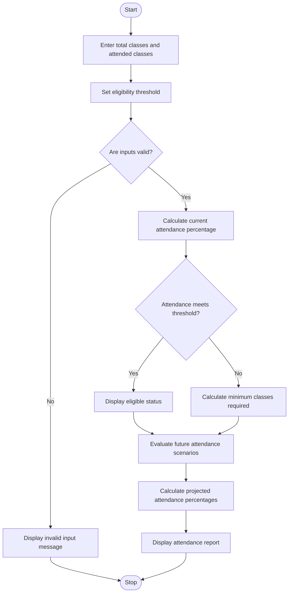

1. Problem Statement
The Attendance Recovery Computation system calculates a student's current attendance percentage using the total classes conducted and classes attended. It determines the minimum number of consecutive classes the student must attend to reach a required attendance eligibility threshold. The program also evaluates different future attendance scenarios, helps students understand their attendance status, and identifies whether they are eligible for examinations based on the specified attendance requirement.
2. Algorithm
1. Start the program.
2. Input the total number of classes conducted and the number of classes attended.
3. Set the required attendance eligibility percentage.
4. Validate the input values.
5. Calculate the current attendance percentage.
6. Check whether the student has already reached the eligibility threshold.
7. If the student is below the threshold, calculate the minimum number of consecutive classes required to reach it.
8. Calculate the required classes using the attendance eligibility formula.
9. Evaluate different future attendance scenarios.
10. Display the current attendance percentage, required classes, and projected attendance percentages.
11. Display the student's eligibility status.
12. Stop the program.
3. Flowchart Using Mermaid

code 
import math
Attendance Recovery Computation
Input attendance details
total_classes = 60
attended_classes = 42
eligibility_threshold = 75
Validate attendance data
if (
total_classes <= 0
or attended_classes < 0
or attended_classes > total_classes
or not 0 < eligibility_threshold <= 100
):
print("Invalid attendance details.")

else:
# Calculate current attendance percentage
current_percentage = attended_classes / total_classes * 100
print("=" * 50)
print("       ATTENDANCE RECOVERY REPORT")
print("=" * 50)

print("Total Classes Conducted :", total_classes)
print("Classes Attended        :", attended_classes)
print("Current Attendance      :", round(current_percentage, 2), "%")
print("Eligibility Threshold   :", eligibility_threshold, "%")

# Calculate minimum consecutive classes required
if current_percentage >= eligibility_threshold:
    required_classes = 0
    print("\nStatus: Already eligible.")
    print("Additional Classes Required: 0")

elif eligibility_threshold == 100:
    required_classes = total_classes - attended_classes
    print("\nStatus: Below eligibility threshold.")
    print("Attend all remaining classes to reach 100%.")

else:
    required_classes = math.ceil(
        (
            eligibility_threshold * total_classes
            - 100 * attended_classes
        )
        / (100 - eligibility_threshold)
    )

    print("\nStatus: Below eligibility threshold.")
    print("Minimum Consecutive Classes Required:",
          required_classes)

# Evaluate future attendance scenarios
scenarios = [
    ("Attend all next 10 classes", 10, 10),
    ("Attend 8 of next 10 classes", 10, 8),
    ("Attend 5 of next 10 classes", 10, 5)
]

print("\nFUTURE ATTENDANCE SCENARIOS")
print("-" * 50)

for description, future_classes, future_attended in scenarios:
    projected_total = total_classes + future_classes
    projected_attended = attended_classes + future_attended

    projected_percentage = (
        projected_attended / projected_total
    ) * 100

    print(description)
    print("Projected Attendance:",
          round(projected_percentage, 2), "%")

    if projected_percentage >= eligibility_threshold:
        print("Eligibility: Eligible")
    else:
        print("Eligibility: Not yet eligible")

    print("-" * 50)
print("Report generated successfully.")
5. Sample Output
==================================================
       ATTENDANCE RECOVERY REPORT
==================================================
Total Classes Conducted : 60
Classes Attended        : 42
Current Attendance      : 70.0 %
Eligibility Threshold   : 75 %

Status: Below eligibility threshold.
Minimum Consecutive Classes Required: 12

FUTURE ATTENDANCE SCENARIOS
--------------------------------------------------
Attend all next 10 classes
Projected Attendance: 74.29 %
Eligibility: Not yet eligible
--------------------------------------------------
Attend 8 of next 10 classes
Projected Attendance: 71.43 %
Eligibility: Not yet eligible
--------------------------------------------------
Attend 5 of next 10 classes
Projected Attendance: 67.14 %
Eligibility: Not yet eligible
--------------------------------------------------

Finishing up
