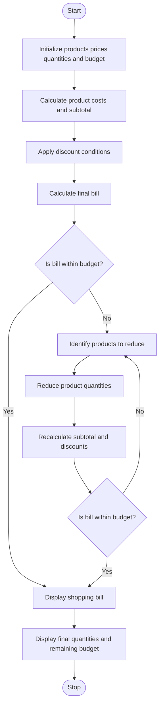

1. Problem Statement
The Multi-Product Shopping Budget Constraint system evaluates a shopping basket containing multiple products and their quantities. It calculates the total cost of each product, applies discounts based on purchase conditions, and determines whether the final shopping cost exceeds the available budget. If the total exceeds the budget, the program identifies which product quantities should be reduced to bring the shopping cost within the budget. Finally, it displays the product details, discounts, final bill, and remaining budget.
2. Algorithm
1. Start the program.
2. Initialize the product names, prices, quantities, and available shopping budget.
3. Calculate the cost of each product by multiplying its price by its quantity.
4. Calculate the subtotal of all products.
5. Apply discounts according to the shopping conditions.
6. Calculate the total bill after discounts.
7. Compare the final bill with the available budget.
8. If the bill is within the budget, display the shopping bill.
9. Otherwise, identify products whose quantities can be reduced.
10. Reduce product quantities until the total bill fits within the budget, recalculating discounts when necessary.
11. Display the adjusted quantities, final bill, savings, and remaining budget.
12. Stop the program.
3. Flowchart (Mermaid)

4. Python Program
# Multi-Product Shopping Budget Constraint

products = [
    ["Rice Bag", 800, 2],
    ["Cooking Oil", 200, 3],
    ["Biscuits", 50, 4],
    ["Soap", 40, 5]
]

budget = 2000

def calculate_bill(items):
    subtotal = 0
    product_costs = []
    total_discount = 0

    for item in items:
        name, price, quantity = item
        cost = price * quantity
        subtotal += cost

        # Apply 10% discount when quantity is 3 or more
        if quantity >= 3:
            discount = cost * 0.10
        else:
            discount = 0

        product_costs.append(
            (name, price, quantity, cost, discount)
        )
        total_discount += discount

    # Calculate subtotal after product discounts
    discounted_subtotal = subtotal - total_discount

    # Apply additional 5% discount if subtotal is at least Rs. 3000
    extra_discount = 0

    if subtotal >= 3000:
        extra_discount = discounted_subtotal * 0.05

    final_bill = discounted_subtotal - extra_discount
    total_discount += extra_discount

    return (
        subtotal,
        product_costs,
        total_discount,
        final_bill
    )

print("=" * 60)
print("       MULTI-PRODUCT SHOPPING BUDGET CONSTRAINT")
print("=" * 60)

print("Available Budget: Rs.", budget)

# Calculate initial bill
subtotal, details, discount, final_bill = calculate_bill(products)

# Reduce quantities if the bill exceeds the budget
while final_bill > budget:
    # Find products with the highest unit price and quantity above zero
    candidates = [
        item for item in products if item[2] > 0
    ]

    if not candidates:
        break

    # Select the most expensive product
    most_expensive = max(candidates, key=lambda item: item[1])

    # Reduce its quantity by one
    most_expensive[2] -= 1

    # Recalculate the bill and discounts
    subtotal, details, discount, final_bill = calculate_bill(products)

# Display final shopping bill
print("\nFINAL SHOPPING BILL")
print("-" * 60)

print(f"{'Product':<18}{'Price':>8}{'Qty':>6}{'Cost':>10}{'Discount':>12}")
print("-" * 60)

for name, price, quantity, cost, product_discount in details:
    print(
        f"{name:<18}{price:>8}{quantity:>6}"
        f"{cost:>10.2f}{product_discount:>12.2f}"
    )

print("-" * 60)
print("Subtotal           : Rs.", round(subtotal, 2))
print("Total Discount     : Rs.", round(discount, 2))
print("Final Bill         : Rs.", round(final_bill, 2))
print("Available Budget   : Rs.", budget)
print("Remaining Budget   : Rs.", round(budget - final_bill, 2))

if final_bill <= budget:
    print("\nStatus: Shopping is within the budget.")
else:
    print("\nStatus: Budget cannot be met with the available products.")

print("\nADJUSTED PRODUCT QUANTITIES")

for name, price, quantity in products:
    print(name, ":", quantity, "unit(s)")

print("=" * 60)

5. Sample Output
============================================================
       MULTI-PRODUCT SHOPPING BUDGET CONSTRAINT
============================================================
Available Budget: Rs. 2000

FINAL SHOPPING BILL
------------------------------------------------------------
Product              Price   Qty      Cost    Discount
------------------------------------------------------------
Rice Bag               800     1    800.00        0.00
Cooking Oil            200     3    600.00       60.00
Biscuits                50     4    200.00       20.00
Soap                    40     5    200.00       20.00
------------------------------------------------------------
Subtotal           : Rs. 1800
Total Discount     : Rs. 100.0
Final Bill         : Rs. 1700.0
Available Budget   : Rs. 2000
Remaining Budget   : Rs. 300.0

Status: Shopping is within the budget.
